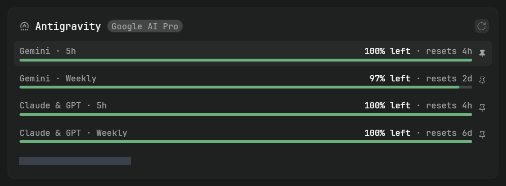

# Paseo Antigravity Usage

<p align="center"></p>

Antigravity CLI (`agy`) quota monitoring in [Paseo](https://paseo.sh)'s native **Settings → Usage** page.



*Captured from Paseo on Windows with live quota data. The account email is redacted.*

## Highlights

- **Four quota windows:** Gemini and Claude & GPT, each with 5-hour and weekly quotas.
- **Native usage card:** consumption bars, reset countdowns, a subscription badge, and the signed-in account email.
- **Automatic discovery:** finds the local CLI and reads its login from the operating system credential store.
- **Clear diagnostics:** expired or rejected logins use Paseo's built-in guidance. Missing quota readings stay unknown instead of appearing unused.

## Requirements

- Paseo **0.11.0 or later**.
- Antigravity CLI (`agy`) installed and signed in **as the user running the Paseo daemon**.
- npm available on the daemon machine for the locked dependency installation.

| Platform | Credential store | Status |
| --- | --- | --- |
| Windows | Credential Manager, `gemini:antigravity` | Verified against a real login and Google quota responses |
| macOS | Keychain, service `gemini`, account `antigravity` | Adapter implemented; real-host verification pending |
| Linux | Secret Service, via `secret-tool` | Adapter implemented; requires an unlocked desktop keyring; real-host verification pending |

## Installation

Install directly from GitHub, without an npm package or registry listing:

```bash
paseo plugin add git:breathi3552/paseo-agy-usage
paseo plugin ls
```

The Git source follows the repository's default branch. Select a published tag with `--ref vX.Y.Z` when installing a release. The `git:` prefix selects direct Git installation rather than the Paseo plugin registry.

Open **Settings → Usage** on the same host. The Antigravity account is discovered automatically when the CLI and login are available. If Paseo's global plugin switch is off, enable it in Settings first.

To update a Git installation:

```bash
paseo plugin update paseo-agy-usage
```

## Credentials and data access

The plugin reads the specific Antigravity login item from the daemon user's OS credential store. It uses the access token for HTTPS requests to `cloudcode-pa.googleapis.com`, retrieving quota and subscription information. The stored ID token is decoded locally to obtain the account email when a separate email field is unavailable.

Tokens stay server-side and are excluded from saved account inputs, usage reports, and logs. Login renewal stays with `agy`; the plugin neither redeems refresh tokens nor writes to the credential store. Run `agy` to renew the login when Paseo reports an expired or rejected token.

Account discovery is global. It does not attribute the daemon user's login to individual agent sessions. On free plans, 5-hour buckets may remain full; use weekly quotas to track consumption.

## Local development

Use Node.js 24, pinned in `.nvmrc` and `.node-version`.

```bash
git clone https://github.com/breathi3552/paseo-agy-usage.git
cd paseo-agy-usage
npm ci --ignore-scripts
npm run check
paseo plugin install .
```

After source changes:

```bash
paseo plugin reload paseo-agy-usage
paseo plugin logs paseo-agy-usage
```

The behavior tests run the real credential parsing, account discovery, and report mapping with filesystem, OS credential, and HTTP I/O replaced. They do not require a live login or contact Google.

## Releases

Distribution is **GitHub-only**. The package remains `private: true` to prevent accidental npm publishing. Git installations use the committed source and `package-lock.json`; Paseo installs runtime dependencies with `npm ci --omit=dev --ignore-scripts` and compiles the TypeScript entry itself.

CI checks changes on Windows and Linux. Pushing a `vX.Y.Z` tag runs the release checks and creates a GitHub Release with GitHub's source archives. See [the release guide](./docs/releasing.md) for versioning, host acceptance, and Paseo registry submission.

## References

- [Plugin overview](./OVERVIEW.md)
- [Changelog](./CHANGELOG.md)
- [Implementation notes and remaining work](./TODO.md)
- [Paseo usage source API](https://paseo.sh/docs/plugins/reference.md#usage-sources)
- [Paseo plugin publishing](https://paseo.sh/docs/plugins/publishing.md)

## License

[MIT](./LICENSE)
